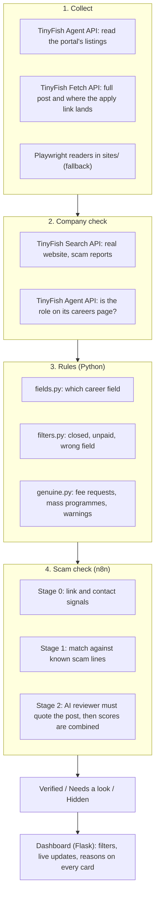

<div align="center">

<p align="center"><picture><source media="(prefers-color-scheme: dark)" srcset="docs/readme/banner-dark.svg"><source media="(prefers-color-scheme: light)" srcset="docs/readme/banner-light.svg"></picture></p>

[](https://python.org)
[](https://flask.palletsprojects.com)
[](https://www.tinyfish.ai/)
[](https://n8n.io)
[](LICENSE)

</div>

**Internships you can trust.** InReal collects internships from the big Indian and international portals into one list, and checks every post for scams before a student sees it.

Built by **Team Chiranjivi**. First shown at the CodeX 3.0 grand finale, PIET Panipat (October 2026). For **Kritical Hacks 2026** we are moving all the web reading onto **TinyFish** web agents.

---

## Why we built this

Fake internships look just like real ones. A student gets a proper offer, sits an interview, and is then asked to pay a "registration", "training" or "verification" fee. The catch is never in the title. It sits deep in the description, or arrives on WhatsApp after you apply.

When we ran our scraper on six portals on 12 October 2026, we read **2,176** AI/ML internship posts. Only **451** passed our checks. The rest were off-topic, already closed, unpaid, or asked the student for money.

<p align="center"><picture><source media="(prefers-color-scheme: dark)" srcset="docs/readme/funnel-dark.svg"><source media="(prefers-color-scheme: light)" srcset="docs/readme/funnel-light.svg"></picture></p>

<sub>Per-portal counts from the laptop test runs logged in [SELECTOR_TRACKER.md](SELECTOR_TRACKER.md).</sub>

## What InReal does

- **One list from many sites.** Internshala, Unstop, Naukri, LinkedIn, Shine, Foundit, Apna and the government's AICTE portal, plus searches for university and research-lab positions.
- **12 career fields, not just tech.** AI/ML, software, data, medicine, pharma and biotech, core engineering, finance, marketing, design, content, HR and operations, and law.
- **Hides posts that ask students to pay.** Registration, training or security fees, deposits, "pay ₹999 to book your slot", task-for-money schemes, and mass "internship" programmes that "hire" thousands. Fee requests written in Hinglish ("fees jama karni hogi") are caught too.
- **Warns without hiding** when something looks odd: a brand-new employer with no hires, one post copied across many towns, a training course sold as an internship, or no stated stipend.
- **Shows its reasons.** Every post is marked **Verified**, **Needs a look** or **Hidden**, and the card says why.
- **Never sits in the middle.** Students apply on the original site. InReal never asks anyone for money or documents.

---

## Where TinyFish comes in

Our first version reads each portal by its exact page layout (CSS selectors in `sites/*.py`). Portals change their pages often, and when they do, the reader comes back empty. On 12 October 2026 we had to rewrite the readers for seven portals. Naukri hides later pages behind a captcha token, and company career pages we could only link to, never read.

TinyFish fixes that. Instead of writing layout code for every site, we give a TinyFish agent a page and a goal in plain English, and it returns clean JSON.

<p align="center"><picture><source media="(prefers-color-scheme: dark)" srcset="docs/readme/tinyfish-dark.svg"><source media="(prefers-color-scheme: light)" srcset="docs/readme/tinyfish-light.svg"></picture></p>

| Job | TinyFish API | What it replaces today | Status |
|---|---|---|---|
| Read each portal's listings | Agent API | Playwright + CSS selectors in `sites/*.py` | Kritical Hacks build |
| Open the full post and follow the apply link | Fetch API | Playwright detail pages and `moderation/link_check.py` | Kritical Hacks build |
| Look the company up on the web | Search API | DuckDuckGo search through `ddgs` | Kritical Hacks build |
| Check the role is on the company's own careers page | Agent API | Nothing yet (`sites/bigtech.py` only links out) | Kritical Hacks build |

An example request to the Agent API:

```http
POST https://agent.tinyfish.ai/v1/automation/run-sse
X-API-Key: <TINYFISH_API_KEY>
Content-Type: application/json

{
  "url": "https://internshala.com/internships/machine-learning-internship/",
  "goal": "List every internship on this page. For each one give the title, company, stipend, duration, location and apply link. Return JSON."
}
```

The run streams its progress while it works and ends with structured JSON. When the portal redesigns its page, the goal stays the same.

**Keeping it cheap.** TinyFish Search and Fetch are free up to a daily limit, so most checks cost nothing. Paid Agent runs go only to pages that need a real browser. The current Playwright readers stay as a fallback.

---

## How a post gets checked



### The AI can't hide a post on its own

- **Stage 0** looks at the apply link and contact details: link shorteners, WhatsApp or Telegram links, Google Forms, UPI IDs, free-mail recruiters, phone numbers.
- **Stage 1** compares every sentence of the post with about 50 known scam phrases and about 15 honest ones, so "we do **not** charge any fee" doesn't match "pay the registration fee". A near-copy of a high-risk scam is blocked here without any AI call.
- **Stage 2** makes one AI call per post. The reviewer has to quote the exact line it objects to. Quotes that aren't really in the post are thrown away, and a high score with no surviving quote is pulled back to about 0.5.
- The final risk is `0.6 × AI reviewer + 0.25 × phrase match + 0.15 × rules`, so the AI alone can push a post to **Needs a look**, never to **Hidden**. If the AI and the phrase match disagree by 0.6 or more, a person decides.

<p align="center"><picture><source media="(prefers-color-scheme: dark)" srcset="docs/readme/formula-dark.svg"><source media="(prefers-color-scheme: light)" srcset="docs/readme/formula-light.svg"></picture></p>

The whole workflow is in `n8n/inreal_moderation.json`. Import it into n8n (Create workflow → Import from file) and add your Gemini key as a credential.

---

## Project structure

```
InReal_v1/
├── app.py                  Flask app, APIs, read-only guard for public visitors
├── fields.py               the 12 career fields
├── filters.py              eligibility, keywords, stipend and date checks
├── genuine.py              fee and fake-programme rules, employer warnings
├── scraper.py              runs the site readers, folds copied posts together
├── scraper_utils.py        browser helpers, delays, alerts
├── output_handler.py       thread-safe CSV/JSON store
├── scheduler.py            scheduled scraping
├── test_sites.py           dry-run every portal, one by one
├── SELECTOR_TRACKER.md     selector history and test results per portal
├── THIRD_PARTY_NOTICES.md  upstream project and dependency licences
├── LICENSE
│
├── docs/ip-review/         what came from upstream and what we built
├── moderation/             link check, scam-phrase index, re-checks, Azure check
├── n8n/                    the moderation workflow and its code steps
│   ├── inreal_moderation.json
│   └── code/               signals.js, vector_search.js, judge_prompt.js, fuse.js, ...
├── sites/                  one reader per portal (Internshala, Unstop, Naukri, LinkedIn, ...)
├── static/                 dashboard script and images
├── templates/              index.html (the dashboard)
└── tests/                  pytest suite, with saved copies of live pages
```

---

## Setup

You need Python 3.9 or newer (3.11 recommended), Google Chrome, and Node.js 24 or newer if you run n8n.

```bash
git clone https://github.com/akshat-gupta-111/InReal_v1.git
cd InReal_v1

python -m venv venv
venv\Scripts\activate          # Windows
source venv/bin/activate       # macOS / Linux

pip install -r requirements.txt
python -m playwright install chromium
```

Copy `.env.example` to `.env` and fill in your keys. Never commit `.env`.

```bash
# AI for the scam check: Gemini, or Azure OpenAI
GEMINI_API_KEY=your-gemini-key
EMBED_PROVIDER=gemini

# n8n workflow
INREAL_N8N_WEBHOOK=http://localhost:5678/webhook/inreal-moderate

# Optional: token for admin actions from outside your laptop
INREAL_ADMIN_TOKEN=your-token

# TinyFish web agents (Kritical Hacks build)
TINYFISH_API_KEY=your-tinyfish-key
```

Build the scam-phrase index (about 10 seconds):

```bash
python -m moderation.build_index
```

Run the app and open http://localhost:5000:

```bash
python app.py
```

For a read-only public demo link through Cloudflare Tunnel, run `run_public.bat` on Windows.

## Testing

```bash
python -m pytest tests -q                              # offline tests on saved pages
python scraper.py --source internshala --dry-run       # one portal, nothing saved
python test_sites.py                                   # every portal, one by one
python test_sites.py --field medical                   # another career field
```

A dry run prints how many posts were kept or dropped and why, and writes every post with its reason to `test_output/<portal>.csv`.

---

## Team Chiranjivi

Parv Mishra, Abhishek Goswami, Akshat Gupta, Anirudh Kumar, Dhruv Bhardwaj

## Credits and licence

InReal started from [Internship_Scraper](https://github.com/Srikant-03/Internship_Scraper) by Srikant Choubey (Srikant-03), under the MIT licence. On top of it we built the genuine-only rules, the n8n scam check, the 12 career fields, the portal fixes, and the TinyFish integration. [THIRD_PARTY_NOTICES.md](THIRD_PARTY_NOTICES.md) and [docs/ip-review/](docs/ip-review/) list exactly what came from upstream and what is ours.

Released under the MIT licence. See [LICENSE](LICENSE).
