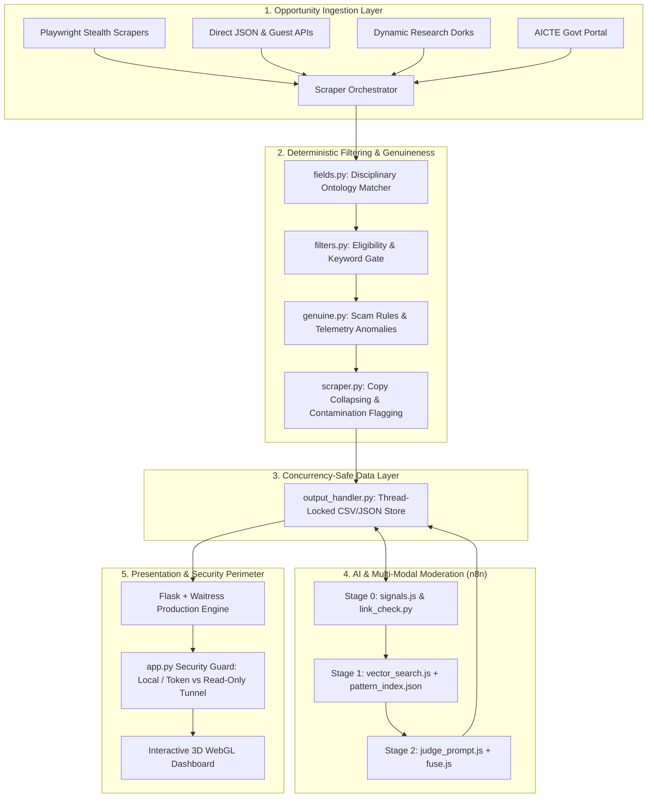

# InReal: AI-Powered Opportunity Discovery & Fraud Detection Platform

[](https://python.org)
[](https://flask.palletsprojects.com)
[](https://playwright.dev)
[](LICENSE)

**InReal** is an intelligent opportunity discovery and fraud-detection engine engineered for students, graduates, and researchers. It aggregates internships and research residencies across 60+ global platforms, verifies listing authenticity through a multi-stage evidence fusion pipeline, and presents clean, verified opportunities on an interactive, real-time dashboard.

---

## 🚀 Key Capabilities

- 🌐 **Multi-Platform Aggregation:** Scrapes and synchronizes listings across 60+ sources spanning India and international portals (Internshala, Unstop, Naukri, LinkedIn Jobs guest API, Shine, Foundit, Apna, AICTE Government portal, BigTech career endpoints, and dynamic university discovery dorks).
- 🧭 **Multi-Disciplinary Coverage:** Beyond computing, InReal supports 12 career disciplines: AI/ML, Software Development, Data Analytics, Healthcare & Medicine, Pharma & Biotech, Core Engineering, Finance, Marketing, Design, Content & Media, HR & Operations, and Law.
- 🛡️ **Autonomous Fraud & Scam Defense (`genuine.py`):**
  - Flags or blocks listings with upfront registration fees, security deposits, training charges, or prepaid task-for-money schemes.
  - Detects mass-hiring anomalies (e.g. 10,000+ "hired" from automated postings).
  - Flags suspicious recruiter metrics (brand new employers with 0 hires, high post-to-hire skew, multi-town flood posting).
- 🔎 **Multi-Stage Moderation Pipeline (`moderation/` & `n8n/`):**
  - **Stage 0 (Signals):** Validates redirect chains, final domain legitimacy, HTTP status, and detects high-risk contact channels (UPI payment handles, free webmail domains, WhatsApp/Telegram recruiter redirection).
  - **Stage 1 (Vector Search):** Semantic chunk comparison against a calibrated bank of scam patterns using normalized embeddings and contrastive honest-wording margin enforcement.
  - **Stage 2 (Evidence-Verified LLM Judge & Fusion):** Generative reasoning that requires verbatim evidence extraction, discounts ungrounded claims, and combines multi-modal scores with automatic human-review escalation upon divergence.
- 🔄 **Copy Collapsing & Contamination Propagation:** Automatically clusters duplicate flood postings, aggregates disparate location warnings, and propagates distrust tags across listings from known deceptive training sellers.
- ⚡ **Production-Ready & Secure:**
  - Thread-safe data persistence with Windows-compatible retry backoff.
  - Tunnel-aware security layer enforcing read-only access for external visitors via Cloudflare tunnels while gating admin operations behind secure authentication.
  - High-concurrency WSGI serving with Waitress (Windows) or Gunicorn (Linux).

---

## 🏗️ Architecture Overview



---

## 📦 Project Structure

```text
InReal_v1/
├── app.py                   # Flask application, REST APIs, and perimeter access control
├── fields.py                # Multi-disciplinary career ontology definitions
├── filters.py               # Eligibility, keyword, stipend, and date parsing
├── genuine.py               # Rule-based scam detection and employer anomaly checks
├── output_handler.py        # Concurrency-safe CSV/JSON sync and round-robin queue
├── scraper.py               # Multi-source scraper orchestrator and copy-collapsing engine
├── scraper_utils.py         # Anti-bot stealth utilities, delays, and alert dispatch
├── scheduler.py             # Scheduled scraping background process
├── test_sites.py            # Diagnostic utility for dry-running portal scrapers
├── SELECTOR_TRACKER.md      # Detailed selector upgrade history across all platforms
├── THIRD_PARTY_NOTICES.md   # Third-party licensing, dependencies, and upstream attribution
├── LICENSE                  # MIT License with upstream attribution
│
├── moderation/              # Verification & Moderation Services
│   ├── build_index.py       # Embedding index generator & calibration script
│   ├── check_azure.py       # Azure OpenAI endpoint diagnostics
│   ├── env.py               # Environment loader
│   ├── link_check.py        # HTTP redirect resolution & expired listing detector
│   ├── notify.py            # n8n webhook notification dispatcher
│   ├── recheck.py           # Listing re-check and validation utility
│   └── scam_patterns.json   # Seed bank of known deceptive patterns & honest anchors
│
├── n8n/                     # Workflow Automation & Evidence Fusion
│   ├── build_workflow.py    # n8n workflow synthesizer
│   ├── inreal_moderation.json # Full n8n visual moderation workflow
│   └── code/                # Node.js pipeline components
│       ├── signals.js       # Stage 0: Link and contact signal extraction
│       ├── vector_search.js # Stage 1: Calibrated vector semantic search
│       ├── judge_prompt.js  # Stage 2: Generative judge prompt with evidence requirements
│       ├── fuse.js          # Stage 2b: Verbatim quote verification & multi-modal fusion
│       └── ...
│
├── sites/                   # Portal Scraper Implementations
│   ├── internshala.py       # Internshala Playwright scraper
│   ├── unstop.py            # Unstop internal JSON API scraper
│   ├── naukri.py            # Naukri visible browser + schema.org JSON-LD extractor
│   ├── linkedin.py          # LinkedIn guest job search & detail API scraper
│   ├── shine.py             # Shine server-rendered article & schema.org parser
│   ├── foundit.py           # Foundit JSON endpoint scraper
│   ├── apna.py              # Apna search & schema.org extractor
│   ├── government.py        # AICTE National Internship Portal API ingestion
│   ├── universities.py      # DuckDuckGo dynamic lab & research fellowship discovery
│   └── ...
│
├── static/                  # Static Assets & Client-Side Scripts
│   ├── app_radar.js         # Reactive dashboard controller, real-time filters & SSE
│   └── ...                  # SVG graphics and team illustrations
├── templates/
│   └── index.html           # Modern glassmorphism dashboard with 3D WebGL canvas
└── tests/                   # Automated Test Suite (pytest)
    ├── test_moderation.py   # Full moderation pipeline and fusion test
    ├── test_save.py         # Concurrency and data synchronization tests
    ├── test_fields.py       # Multi-disciplinary ontology tests
    ├── test_public_guard.py # Perimeter security and tunnel access guard tests
    └── ...                  # Platform-specific scraper and parser tests
```

---

## 🛠️ Quick Start & Installation

### 1. Prerequisites
- Python 3.9+ (Python 3.11+ recommended)
- Node.js (for n8n moderation pipeline tests)
- Google Chrome or Chromium (installed via Playwright)

### 2. Environment Setup
```powershell
# Clone the repository
cd InReal_v1

# Create and activate virtual environment
python -m venv venv
.\venv\Scripts\activate

# Install required dependencies
pip install -r requirements.txt

# Install Playwright browser binaries
playwright install chromium
```

### 3. Configuration
Copy `.env.example` to `.env` and supply your API credentials:
```env
# Azure OpenAI (or Gemini) for embeddings and LLM judge
AZURE_OPENAI_EMBEDDING_ENDPOINT=https://YOUR-EMBED-RESOURCE.openai.azure.com/
AZURE_OPENAI_EMBEDDING_KEY=your-key
AZURE_OPENAI_GPT4O_ENDPOINT=https://YOUR-GPT4O-RESOURCE.openai.azure.com/
AZURE_OPENAI_GPT4O_KEY=your-key

# Alternatively, set Gemini API key:
GEMINI_API_KEY=your-gemini-key
EMBED_PROVIDER=gemini

# n8n webhook URL
INREAL_N8N_WEBHOOK=http://localhost:5678/webhook/inreal-moderate

# Optional token for remote administrative writes:
INREAL_ADMIN_TOKEN=your-secure-token
```

### 4. Build Pattern Embeddings
Generate the vector index for semantic moderation:
```powershell
python -m moderation.build_index
```

### 5. Running the Application
```powershell
# Start InReal dashboard with Waitress production server (debug off)
python app.py
```
Open `http://localhost:5000` in your browser.

To expose a secure, read-only public demo link via Cloudflare Tunnel:
```powershell
.\run_public.bat
```

### 6. Executing Tests
Run the comprehensive offline test suite:
```powershell
.\venv\Scripts\pytest
```

---

## 📋 Scraping Operations & Dry Runs

Run a specific platform in dry-run mode (outputs detailed kept/dropped analytics to `test_output/<platform>.csv` without touching the main database):
```powershell
python scraper.py --source internshala --dry-run
```

Test all platforms sequentially:
```powershell
python test_sites.py
```

Test opportunities for a specific discipline:
```powershell
python test_sites.py --field medical
```

---

## 📜 Intellectual Property & Upstream Attribution

InReal builds upon and substantially refactors foundational web scraping routines from the open-source MIT-licensed project:
* **Upstream Project:** [Internship_Scraper](https://github.com/Srikant-03/Internship_Scraper) by Srikant-03.
* **License:** MIT License.

All newly developed features—including the multi-stage fraud moderation pipeline, contrastive semantic pattern calibration, verbatim evidence-verified LLM fusion, copy collapsing, cross-post contamination propagation, multi-disciplinary ontologies, and secure concurrency architectures—are original contributions of the InReal engineering team.

Detailed provenance, third-party dependency licenses, and intellectual property reviews are documented in:
* [LICENSE](LICENSE)
* [THIRD_PARTY_NOTICES.md](THIRD_PARTY_NOTICES.md)
* [docs/ip-review/](docs/ip-review/)
