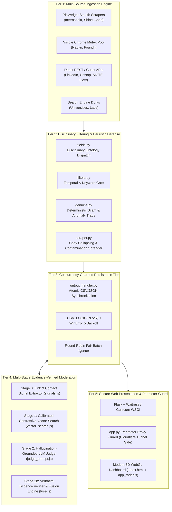
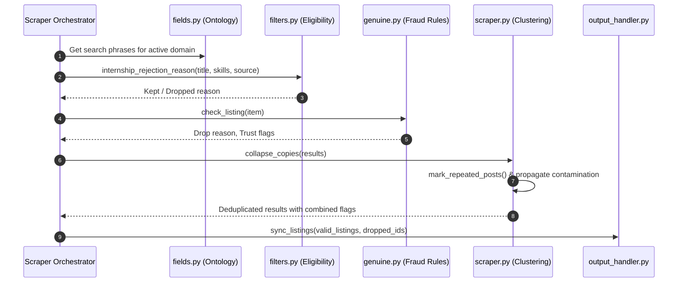
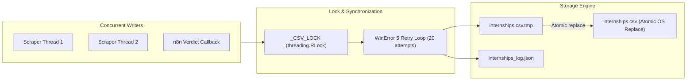
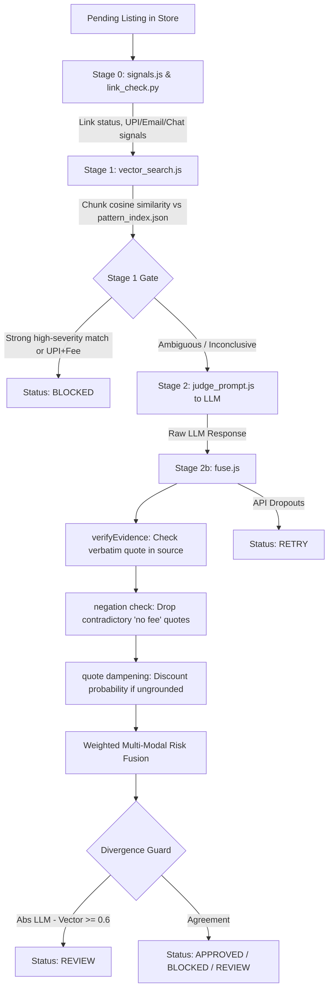

# InReal: Technical Architecture Specification

**Document Reference:** `INREAL-IP-AUD-003`  
**Classification:** Internal Confidential / IP Review  
**Date of Specification:** October 15, 2026  

---

## 1. System Overview and Architectural Tiers

InReal is structured into five distinct operational tiers designed to ensure modularity, concurrency safety, and high-availability opportunity discovery and verification:

---

## 2. Ingestion Layer (Tier 1)

The ingestion layer interfaces with third-party web portals, job boards, and academic endpoints to harvest opportunity records.

### 2.1 Multi-Protocol Driver Architecture
1. **Headless Browser Automation with Stealth:**  
   Utilizes Playwright coupled with `playwright-stealth` (`scraper_utils.get_playwright_stealth_args()`) to bypass basic anti-bot fingerprinting (e.g. `AutomationControlled` flags, WebGL vendor masking) on platforms like Internshala, Shine, and Apna.
2. **Interactive Mutex Browser Pool (`visible_chrome`):**  
   Portals protected by aggressive enterprise bot management (such as Akamai on Naukri and Foundit) are executed with visible browser instances. To prevent multiple visible browsers from stealing focus or colliding, a global mutex lock (`visible_chrome = threading.Lock()`) enforces strict serialized execution between these sites.
3. **Internal JSON & Guest API Consumption:**  
   Where portals expose underlying APIs, InReal bypasses brittle DOM parsing:
   * **Unstop:** Directly queries `/api/public/opportunity/search-result?opportunity=internships&oppstatus=open&per_page=250&page=N`.
   * **LinkedIn:** Leverages the guest endpoints `/jobs-guest/jobs/api/seeMoreJobPostings/search` and `/jobs-guest/jobs/api/jobPosting/<id>`, bypassing user authentication walls.
   * **AICTE National Internship Portal:** Consumes official government JSON endpoints for accredited opportunities.
4. **Dynamic Search Discovery:**  
   Uses DuckDuckGo search automation (`ddgs`) to dynamically surface research residencies at international universities (IITs, Max Planck, Oxford, MIT, Stanford) without maintaining brittle static URL lists.

---

## 3. Heuristic Pre-Moderation & Genuineness Layer (Tier 2)

Before any record is persisted, it traverses a deterministic pipeline of domain ontologies, eligibility checks, and scam traps.

### 3.1 Disciplinary Ontology Engine (`fields.py`)
Encapsulates 12 distinct career domains. Scrapers query `fields.search_queries(field_key)` to retrieve targeted search strings. During evaluation, `filters.py` verifies whether role titles align with domain-specific vocabularies.

### 3.2 Deterministic Fraud Traps (`genuine.py`)
* Evaluates textual financial demands (registration fees, kit charges, caution deposits).
* Analyzes platform employer metrics: flags accounts created \(<90\) days ago with 0 hires, accounts with \(>200\) posts and \(<5\%\) hires, and accounts exhibiting mass recruitment (\(\ge 10,000\) hires).

### 3.3 Deduplication & Contamination Propagation (`scraper.py`)
* Groups listings sharing normalized company and title stems (`_company_key` and `_title_key`).
* Collapses \(\ge 3\) copies into a single card while appending all accumulated warning flags.
* Discovers course-selling employers and automatically propagates distrust warnings across all other listings from the same entity in the active run.

---

## 4. Concurrency & Persistence Layer (Tier 3)

The persistence layer coordinates data interchange between background scrapers, the Flask web server, and asynchronous moderation workers.

### 4.1 Concurrency Safety and OS File-Lock Recovery
* **Re-entrant Synchronization:** `_CSV_LOCK = threading.RLock()` protects all write paths.
* **Atomic Replacement:** Updates are serialized to `internships.csv.tmp` and swapped into place using `tmp.replace(CSV_FILE)`.
* **Windows File-Lock Handling:** On Microsoft Windows, file locks held by active read streams trigger `PermissionError` (`WinError 5`). InReal implements an exponential backoff loop executing up to 20 retry attempts with progressive delays:
  \[
  \Delta t_i = 0.1 \times (i + 1) \quad \text{seconds for } i \in [0, 19]
  \]
  guaranteeing zero data corruption or unhandled write crashes.

### 4.2 Fair Queueing & Round-Robin Scheduling
* When n8n requests listings for moderation (`/api/moderation/pending`), `round_robin()` distributes claims evenly across all scraped sources, preventing any single high-volume platform from starving other sources.
* Stale claims older than `CLAIM_TIMEOUT_MIN = 4` minutes are automatically reset to `pending`, recovering from ungraceful n8n or network termination.

---

## 5. Multi-Stage Moderation Tier (Tier 4)

Verification executes out-of-process via an n8n workflow or standalone script engine.

### 5.1 Verification Workflow Nodes
1. **Stage 0 (Signals):** Resolves redirects, detects expired pages, and identifies dangerous contact vectors.
2. **Stage 1 (Vector Search):** Compares text chunks against calibrated embedding vectors (`pattern_index.json`). Requires cosine similarity to exceed `hit_floor` and beat honest phrasing by `margin`.
3. **Stage 2 (LLM Judge):** Asks the LLM to inspect text and return a structured JSON assessment containing verbatim evidence quotes.
4. **Stage 2b (Evidence Verification & Fusion):**
   * Deterministically validates that each quote exists in the source text.
   * Discards hallucinated and negated quotes.
   * Fuses LLM probability (0.6), vector similarity (0.25), and signal weights (0.15).
   * Flags major disagreements (\(\ge 0.6\)) for human review.

---

## 6. Presentation & Security Perimeter Layer (Tier 5)

### 6.1 Perimeter Access Control (`app.py`)
To enable public demonstration via reverse-proxy tunnels (such as Cloudflare Tunnel via `run_public.bat`), InReal inspects request provenance:
* Identifies reverse proxy headers (`Cf-Connecting-Ip`, `Cf-Ray`, `X-Forwarded-For`, etc.).
* Even when the tunnel agent connects from `127.0.0.1`, proxy headers mark the request as external, restricting the client to **read-only** endpoints.
* Write endpoints (`/api/scrape`, `/api/clear`, `/api/moderation/*`) strictly require either genuine unproxied loopback origin or a cryptographically verified `X-InReal-Token` matched via `hmac.compare_digest()`.

### 6.2 Reactive Dashboard Architecture
* **Frontend Controller (`static/app_radar.js`):** Client-side state manager performing real-time polling of alerts (`/api/alerts`) and scraper progress (`/api/scrape/status`).
* **Instant In-Memory Filtering:** Renders cards using CSS Grid `order` properties and client-side memory caching, allowing immediate zero-latency filtering across regions, verification status, stipend tiers, and career fields without server round-trips.
* **3D Canvas (`templates/index.html`):** Renders an interactive WebGL geometric terrain using Three.js as an ambient visual backdrop.
